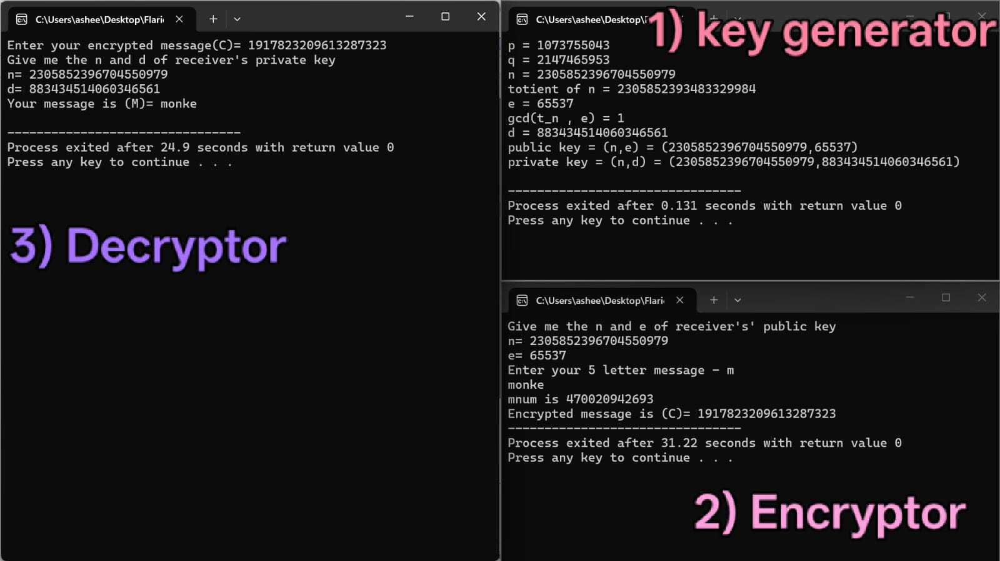

# RSA implementation in C 

IDE used- DevC++

## Features

1. Public and Private Key Generator

2. Message Encryptor

3. Message Decryptor

## Example Image

## Steps

1. Generate RSA public(n,e) and private(n,d) keys.

2. Take a 5-character message and turn it into a number using Base-256 encoding. Then Encrypt using C = M^e mod n.

3. Decrypt using M = C^d mod n. Then convert the resulting number back into text.

## Disclaimer

Its prime numbers are only around the sizes of 2^31 because thats the best long long int could handle.

